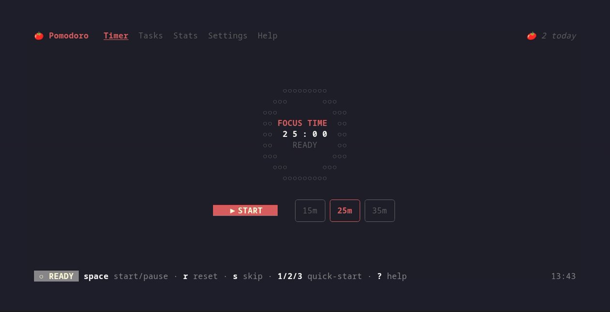
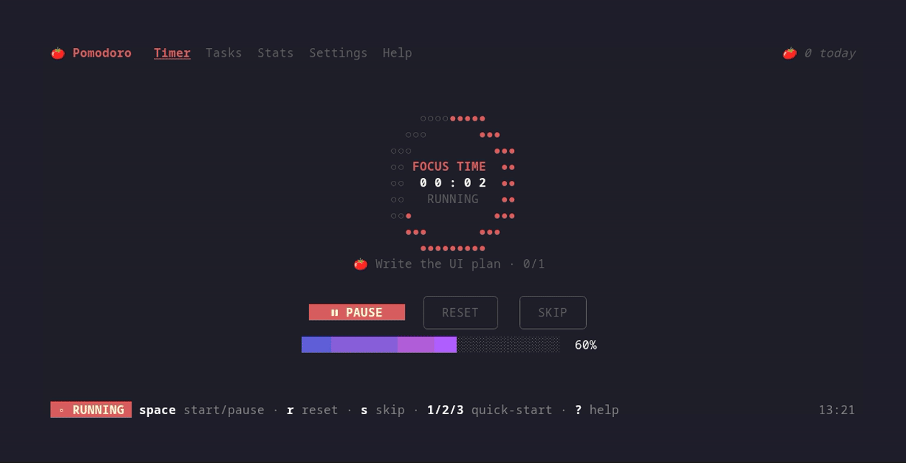
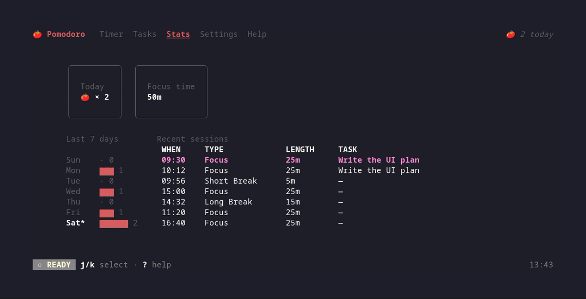
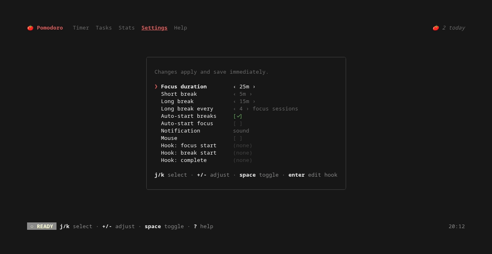
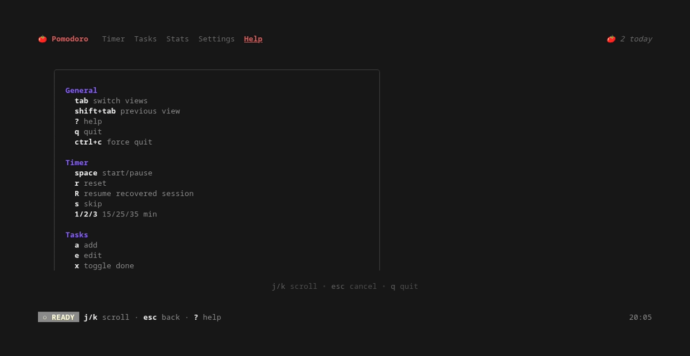
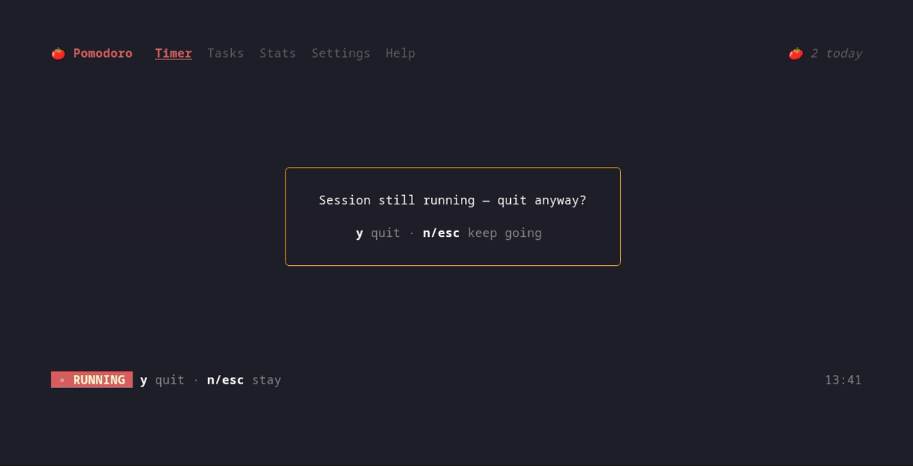

# 🍅 Pomodoro TUI

A terminal-based Pomodoro timer built with [Bubble Tea](https://github.com/charmbracelet/bubbletea), [Bubbles](https://github.com/charmbracelet/bubbles), and [Lip Gloss](https://github.com/charmbracelet/lipgloss).

Focus and break sessions follow the classic rhythm — focus, short break, and a
long break every few rounds — with a progress ring, task tracking, session
history, and settings that survive restarts.

## Screenshots

### Timer





The progress ring sweeps clockwise in the session's color — tomato for focus,
green for short breaks, blue for long breaks — around large digits, with the
current task underneath.

### Tasks


Tasks carry 🍅 estimates vs. completed pomodoros; focusing a task links your
sessions to it. `a` opens a slim add-bar with title, description, and estimate.

### Stats



Today's pomodoros, true focused time (pause-aware), and current/best streaks,
a 13-week activity heatmap, focus-per-task breakdown, and recent sessions with
task attribution. Press `e` to export the full history as JSON.

### Settings



Durations, long-break interval, auto-start behavior, notifications, and an
opt-in mouse mode (wheel scrolling + clickable tabs) — every change applies and
persists immediately.

### Help



A scrollable cheat sheet, available anywhere via `?`.

Quitting while a session runs asks for confirmation first:



## Getting started

```bash
go build -o pomodoro ./cmd
./pomodoro
```

Or run it directly:

```bash
go run ./cmd
```

State (tasks, settings, session history) is stored as JSON in
`~/.config/pomodoro/state.json`. A session still running when you quit is
saved and offered for resume (`R`) on the next launch — if it runs out while
the app is closed, it is credited automatically.

For external integrations the app publishes `$XDG_STATE_HOME/pomodoro/status.json`
(`{"state","remaining_sec","focus_today","task",...}`, refreshed every second)
and can run your own shell hooks on focus start, break start, and completion
(edit them under Settings; commands run with `POMODORO_STATE` set).

Notifications cycle through five modes: the in-app banner, a system sound,
the terminal bell + OSC 9/777 (real desktop notifications on terminals that
support them), desktop notifications via the OS daemon, and silent.

## Keyboard shortcuts

| Key              | Action                                    |
| ---------------- | ----------------------------------------- |
| `space` / `enter`| Start, pause, resume the session          |
| `r`              | Reset to ready (abandons the session)     |
| `s`              | Skip to the next session                  |
| `1` / `2` / `3`  | Quick-start a 15 / 25 / 35 minute focus   |
| `tab`            | Next view (Timer → Tasks → Stats → …)     |
| `shift+tab`      | Previous view                             |
| `a`              | Add a task (Tasks view)                   |
| `x`              | Toggle a task done                        |
| `d`              | Delete a task (`y` confirms)              |
| `e`              | Edit the selected task                    |
| `/`              | Filter tasks (fuzzy; esc clears)          |
| `A`              | Hide/show completed tasks                 |
| `enter`          | Focus the selected task                   |
| `j` / `k`        | Move through lists and panels             |
| `+` / `-`        | Adjust the selected setting (Settings)    |
| `e`              | Export history as JSON (Stats)            |
| `?`              | Help                                      |
| `q`              | Quit (asks for confirmation while running)|
| `esc`            | Cancel / go back                          |

## Repository layout

- `cmd/` — program entry point
- `src/views/` — views, styles, and the root model
- `src/components/` — reusable Bubble Tea components (list, inputs, ring, …)
- `src/models/` — data models and messages
- `src/services/` — timer engine and persistence
- `specs/` — feature specifications and plans
- `docs/` — research notes and the design vision (`docs/layout.md`)
