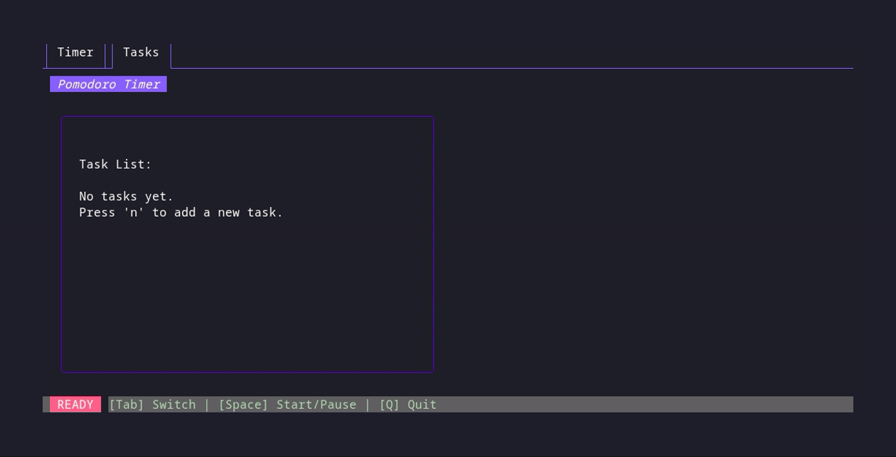

# 🍅 Pomodoro TUI

A terminal-based Pomodoro timer built with [Bubble Tea](https://github.com/charmbracelet/bubbletea), [Bubbles](https://github.com/charmbracelet/bubbles), and [Lip Gloss](https://github.com/charmbracelet/lipgloss).

## Screenshots

### Timer screen


### Tasks screen



## Getting started

```bash
go build -o pomodoro ./cmd
./pomodoro
```

Or run it directly:

```bash
go run ./cmd
```

## Keyboard shortcuts

| Key        | Action                              |
| ---------- | ----------------------------------- |
| `Tab`      | Switch between Timer and Tasks tabs |
| `q`        | Quit                                |
| `Ctrl+C`   | Quit                                |

> Note: the status bar also advertises `[Space]` Start/Pause, but that shortcut isn't wired up yet.

## Repository layout

- `cmd/` — program entry point
- `src/` — views, components, models, and services
- `specs/` — feature specifications and plans
- `docs/` — research notes and library references
